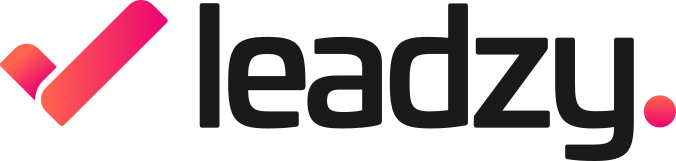
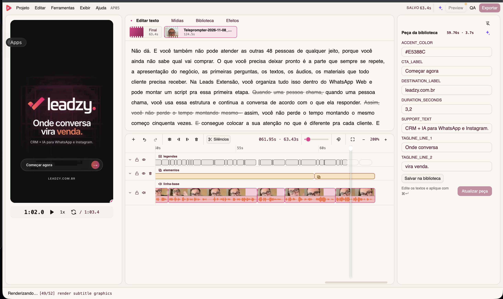

<p align="center">
  <picture>
    <source media="(prefers-color-scheme: dark)" srcset="docs/assets/leadzy-logo-white.svg">
    <source media="(prefers-color-scheme: light)" srcset="docs/assets/leadzy-logo-dark.svg">
    
  </picture>
</p>

<h1 align="center">Leadzy Studio</h1>

<p align="center">
  Local, transcript-first and agent-native video editing for ads and reels.
</p>

<p align="center">
  <a href="README.pt-BR.md">Português</a> ·
  <a href="#install">Install</a> ·
  <a href="#agent-claude-code--codex">Agents</a> ·
  <a href="#desktop-builds">Desktop builds</a>
</p>

<p align="center">
  <a href="LICENSE"></a>
  <a href="package.json"></a>
  
  
</p>

> **Português:** este README também existe em [PT-BR](README.pt-BR.md).



Local, **transcript-first**, **agent-native** video editor for ads, reels and
stories. The word-by-word transcript is the cutting interface: strike a word
through and the cut happens. The same project is editable through the UI **and**
by an AI agent (Claude Code or Codex) — both read and write the same
`edit.json`.

## Why

Editing spoken video (ads, reels, talking heads) is mostly a _text_ problem:
find the good take, remove pauses and stumbles, burn readable captions. Leadzy
Studio makes the transcript the primary timeline, keeps everything on your
machine, and treats AI agents as first-class editors — not a bolted-on chat.

- **Transcript-first** — cut by striking words, never mid-word; snapping,
  padding and silence rules are enforced by the core.
- **Agent-native** — the UI and the agent operate the same files. Edit
  `edit/edit.json` from a Claude Code session and the UI reloads live, marked
  "edited by agent".
- **Local-first** — editing and FFmpeg rendering stay on your machine. The
  only network call is ElevenLabs Scribe, and only when you ask for a
  transcription or a QA pass.
- **Karaoke subtitles** — word-level presets (`pill`, `2p-caps`, `3p-natural`),
  configurable theme (font, weight, solid or gradient fills, pill/outline),
  burned at render time, Instagram safe-zone aware.
- **QA gate** — the final render is re-transcribed and diffed against the edit:
  word order, mid-word cuts and subtitle drift are measured before you call it
  done.

## Install

### One-prompt setup with Claude Code or Codex

Open **Claude Code** or **Codex**, copy the prompt below, and send it. The agent
will read this repository's documentation, install the command and skills, and
open the synthetic demo.

```text
Install and run Leadzy Studio on this computer using only the official repository:
https://github.com/landimt/leadzy-studio

Read README.md and docs/getting-started.md first, then follow the documented setup. Check the requirements, clone the repository if needed, run `make setup`, and then run `make bridge` to install the global `studio` command and the Leadzy Studio skills for Claude Code and Codex. Generate only the synthetic demo with `pnpm example:build`, open it with `pnpm studio open example/media`, keep the Studio running, and tell me the local URL. Do not use personal media, change unrelated projects, edit source code, commit, or push. If a dependency or permission is missing, explain it and ask me before continuing.
```

### Desktop app — recommended for editors

The official desktop package includes Node.js, the UI, SQLite, FFmpeg and
FFprobe. The first public beta will be a signed and notarized Apple Silicon
DMG in the [download feed](https://github.com/leadzy/leadzy-studio-releases/releases).
Until that release is present, use the source setup below; local ad-hoc builds
are development artifacts and should not be redistributed.

| Surface      | Current support                                 |
| ------------ | ----------------------------------------------- |
| Desktop app  | macOS Apple Silicon beta                        |
| Source / CLI | macOS and Linux; Windows is experimental/manual |
| UI language  | Portuguese (Brazil)                             |

### From source — recommended for contributors

Requirements:

- **Node 22.x** (the repository pins 22.14.0) and **pnpm 10.29.1**
- **ffmpeg/ffprobe** on PATH, full build **with libass** (the `subtitles`
  filter)
  - macOS: `make setup` downloads portable builds with libass automatically
  - Windows: full builds at [gyan.dev](https://www.gyan.dev/ffmpeg/builds/)
  - Linux: `apt install ffmpeg` (Debian/Ubuntu include libass)
  - The Studio checks at boot and explains anything missing.
- (Optional) `ELEVENLABS_API_KEY` for Scribe transcription — copy
  `.env.example` to `.env`. Without a key, the algorithmic and manual modes
  keep working.

Clone and prepare the complete environment:

```bash
git clone https://github.com/landimt/leadzy-studio.git
cd leadzy-studio
corepack enable
make setup
```

`make setup` changes only the checkout. To additionally install the global
`studio` command and the Claude Code/Codex skills, run `make bridge` explicitly.

Try a generated project with no personal footage:

```bash
pnpm example:build
pnpm studio open example/media
```

On Windows x64, run `pnpm install --frozen-lockfile`, `pnpm media:setup`,
`pnpm build`, and `pnpm studio open <folder>`. The
[Windows build and validation guide](docs/windows-distribution.pt-BR.md)
covers the installer, native dependencies and verification in a clean account.

Open a creative:

```bash
make dev PROJECT=/absolute/path/to/the/creative
```

Run `make` at any time to see every supported setup, development, quality and
desktop packaging command.

### CLI

Other commands, from anywhere:

```bash
studio doctor
studio open <creative-folder>
studio status <folder> --json        # machine-readable project state + edit hash
studio validate <folder> --json      # schema, media/assets and derived duration
studio transcribe <folder>           # ElevenLabs Scribe v2, verbatim, primed with the doc's keyterms
studio autocut <folder>              # measures silence, applies all pause cuts
studio suggest <folder>              # offline cut candidates (pauses, repetitions, false starts, fillers)
studio library list|add|import|bake  # the personal overlay library, from the terminal
studio edit apply <folder> --file next.json --expect-hash <sha1> --json
studio audio sample <folder> --source cam --in 2.1 --out 2.9 --expect-hash <sha1>
studio audio preview <folder> --json  # A/B .m4a pair: before + processed; no video
studio render <folder> [--preview]
studio qa <folder>
studio search "<spoken text>"
```

`studio` is the canonical command in creative folders. Contributors can still
use `pnpm studio …` while working inside this repository.

The creative folder holds the original media (never modified) and `edit/` with
everything the Studio generates: `edit.json` (source of truth), transcripts,
waveforms, subtitles, renders and QA reports.

The visual **Transcribe** workspace uses ElevenLabs Scribe, shows project
usage/history, and only processes media without a current transcript
(missing, media file replaced, or keyterms changed).

## Agent (Claude Code / Codex)

The repo ships its own skill in `.claude/skills/leadzy-studio/`. After
`pnpm install`:

```bash
studio install-skill   # installs into ~/.claude/skills and ~/.codex/skills
```

From then on any Claude Code/Codex session knows how to operate the Studio
(`/leadzy-studio`). Every opened creative gets a managed contract at
`edit/agent/leadzy-studio.md`; existing `CLAUDE.md` and `AGENTS.md` files are
preserved. The agent flow uses validated, atomic edits with optimistic hashes
and history. There are no mandatory agent-side dependencies; optional motion
tools should be installed and version-pinned separately.

## Development

```bash
make                    # documented command menu
make check              # typecheck + lint + format + tests + production build
make desktop            # Electron development app with Home and recent projects
make icons              # regenerate web/PWA/macOS icons from the approved mark
make app                # macOS ARM64 .app (local ad-hoc signature)
make dmg                # macOS ARM64 DMG (local ad-hoc signature)
make verify-app         # verify the app signature and bundle identity
make verify-dmg         # verify the image and print its SHA-256
```

Structure: `src/core` (pure, testable) · `src/application` (shared use cases) · `src/server` (Fastify + ffmpeg +
jobs) · `src/client` (React) · `src/cli` · `src/db` (SQLite index;
reindexable — the edit lives in files).

New contributors can continue with the [getting-started guide](docs/getting-started.md),
[architecture map](docs/architecture.md), and
[troubleshooting guide](docs/troubleshooting.md). Planned work is tracked in
the public [roadmap](docs/roadmap.md).

## Desktop builds

The desktop shell uses Electron Forge and reuses the same React/Fastify core as
the CLI. Generated artifacts live in `out/` and are never committed.

The canonical brand source is `assets/brand/leadzy-studio-mark-4096.png`.
`make icons` regenerates the browser favicons, PWA/Apple/Windows assets and the
macOS ICNS from that single approved file.

```bash
make media-tools   # fetch portable ffmpeg + ffprobe for this Mac
make app           # out/Leadzy Studio-darwin-arm64/Leadzy Studio.app
make dmg           # out/make/Leadzy-Studio.dmg
make verify-dmg    # validate the image and print its SHA-256
```

The test build targets Apple Silicon. A public commercial distribution still
requires a Developer ID certificate, hardened runtime, notarization, release
CI and exact FFmpeg source/build notices. See
[the macOS distribution guide](docs/macos-distribution.pt-BR.md) and
[third-party notices](docs/legal/THIRD_PARTY_NOTICES.md).

A Windows x64 installer candidate can be built with
`pnpm desktop:make:win --unsigned`. This is a test artifact; installation,
rendering and updates on Windows must be validated before publication. Follow
[the Windows guide](docs/windows-distribution.pt-BR.md).

## Status

In active development. The F1 milestone was validated end-to-end on real
footage (2026-08-05): word-level cuts with undo, 1080×1920 render with burned
subtitles and −14 LUFS loudnorm, PiP composition, agent round-trip on
`edit.json`, and a green QA (0 mid-word cuts, mean subtitle drift 13 ms /
p95 30 ms).

## License

**Leadzy Studio**, a product of **Leadzy**, is open-source software licensed
under the [GNU Affero General Public License, version 3 only](LICENSE)
(`AGPL-3.0-only`).

- You may use the software for any purpose, including commercial work.
- If you distribute Leadzy Studio or a modified version, you must preserve the
  notices, license the covered work under AGPLv3, and provide its corresponding
  source as required by the license.
- If you run a modified version for users over a network, those users must be
  offered the corresponding source under AGPLv3.
- Videos and other media produced with Leadzy Studio are not covered merely
  because they were created or rendered with the software.

Leadzy offers [alternative commercial licensing](docs/legal/COMMERCIAL-LICENSING.md) for
closed-source distribution, OEM embedding, and other cases that need terms
different from the AGPL. The AGPL does not grant trademark rights in the names
and logos **Leadzy** and **Leadzy Studio**; see the
[trademark policy](docs/legal/TRADEMARKS.md).
Third-party components remain under their own terms as listed in
[third-party notices](docs/legal/THIRD_PARTY_NOTICES.md). This summary is not legal
advice; the [LICENSE](LICENSE) text governs.

## Project policies

- [Contributing](.github/CONTRIBUTING.md)
- [Security reporting](.github/SECURITY.md)
- [Privacy](docs/legal/PRIVACY.md)
- [Code of Conduct](.github/CODE_OF_CONDUCT.md)
