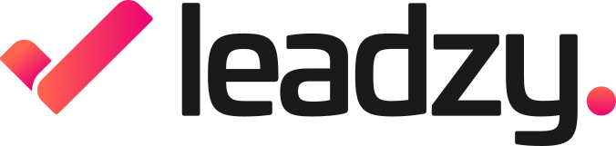
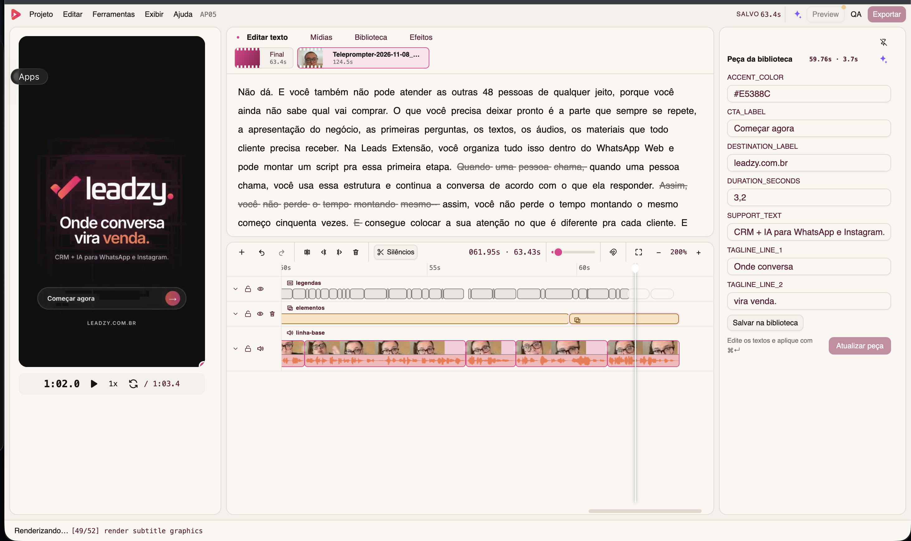

<p align="center">
  <picture>
    <source media="(prefers-color-scheme: dark)" srcset="docs/assets/leadzy-logo-white.svg">
    <source media="(prefers-color-scheme: light)" srcset="docs/assets/leadzy-logo-dark.svg">
    
  </picture>
</p>

<h1 align="center">Leadzy Studio</h1>

<p align="center">
  Edição de vídeo local, transcript-first e agent-native para ads e reels.
</p>

<p align="center">
  <a href="README.md">English</a> ·
  <a href="#instalação">Instalação</a> ·
  <a href="#agente-claude-code--codex">Agentes</a> ·
  <a href="#aplicativo-desktop">Aplicativo desktop</a>
</p>

<p align="center">
  <a href="LICENSE"></a>
  <a href="package.json"></a>
  
  
</p>

> **English:** this README is also available in [English](README.md).



Editor de vídeo local, **transcript-first** e **agent-native**, para ads, reels
e stories. A transcrição palavra a palavra é a interface de corte: riscou a
palavra, cortou. O mesmo projeto é editável pela interface **e** por um agente
de IA (Claude Code ou Codex) — os dois leem e escrevem o mesmo `edit.json`.

## Por quê

Editar vídeo falado (ads, reels, talking heads) é, na maior parte, um problema
de _texto_: achar o take bom, tirar pausas e tropeços, queimar legendas
legíveis. O Leadzy Studio faz da transcrição a timeline principal, mantém tudo
na sua máquina e trata agentes de IA como editores de primeira classe — não um
chat colado por cima.

- **Transcript-first** — corte riscando palavras, nunca no meio de uma; snap,
  padding e regras de silêncio são garantidos pelo core.
- **Agent-native** — a UI e o agente operam os mesmos arquivos. Edite
  `edit/edit.json` de uma sessão do Claude Code e a UI recarrega ao vivo, com
  selo "editado por agente".
- **Local-first** — edição e render com FFmpeg ficam na sua máquina. A única
  chamada de rede é o ElevenLabs Scribe, e só quando você pede uma
  transcrição ou um QA.
- **Legendas karaokê** — presets word-level (`pill`, `2p-caps`, `3p-natural`),
  tema configurável (fonte, peso, preenchimento sólido ou degradê,
  pílula/contorno), queimadas no render, respeitando a zona segura do
  Instagram.
- **Portão de QA** — o render final é retranscrito e comparado com a edição:
  ordem das palavras, cortes no meio de palavra e drift de legenda são medidos
  antes de você dar por pronto.

## Instalação

### Instalação com um prompt: Claude Code ou Codex

Abra o **Claude Code** ou o **Codex**, copie o prompt abaixo e envie. O agente
vai ler a documentação deste repositório, instalar o comando e as skills e
abrir a demonstração sintética.

```text
Instale e execute o Leadzy Studio neste computador usando somente o repositório oficial:
https://github.com/landimt/leadzy-studio

Leia primeiro o README.pt-BR.md e docs/getting-started.md e depois siga o setup documentado. Confira os requisitos, clone o repositório se necessário, rode `make setup` e depois `make bridge` para instalar o comando global `studio` e as skills do Leadzy Studio para Claude Code e Codex. Gere somente a demonstração sintética com `pnpm example:build`, abra com `pnpm studio open example/media`, mantenha o Studio rodando e me informe a URL local. Não use mídia pessoal, não altere outros projetos, não edite o código-fonte, não faça commit e não faça push. Se faltar alguma dependência ou permissão, explique e me pergunte antes de continuar.
```

### Aplicativo desktop — recomendado para editores

O pacote desktop oficial inclui Node.js, interface, SQLite, FFmpeg e FFprobe.
O primeiro beta público será um DMG Apple Silicon assinado e notarizado no
[canal de downloads](https://github.com/leadzy/leadzy-studio-releases/releases).
Até essa versão aparecer, use a instalação pelo código abaixo; builds locais
com assinatura ad-hoc são artefatos de desenvolvimento e não devem ser
redistribuídos.

| Forma de uso        | Suporte atual                              |
| ------------------- | ------------------------------------------ |
| Aplicativo desktop  | beta para macOS Apple Silicon              |
| Código / CLI        | macOS e Linux; Windows experimental/manual |
| Idioma da interface | Português (Brasil)                         |

### Pelo código — recomendado para colaboradores

Requisitos:

- **Node 22.x** (o repositório fixa 22.14.0) e **pnpm 10.29.1**
- **ffmpeg/ffprobe** no PATH, build completo **com libass** (filtro
  `subtitles`)
  - macOS: `make setup` baixa automaticamente builds portáteis com libass
  - Windows: builds completos em [gyan.dev](https://www.gyan.dev/ffmpeg/builds/)
  - Linux: `apt install ffmpeg` (Debian/Ubuntu já incluem libass)
  - O Studio verifica no boot e explica o que falta.
- (Opcional) `ELEVENLABS_API_KEY` para transcrição Scribe — copie
  `.env.example` para `.env`. Sem chave, os modos algorítmico e manual
  continuam funcionando.

Clone e prepare o ambiente completo:

```bash
git clone https://github.com/landimt/leadzy-studio.git
cd leadzy-studio
corepack enable
make setup
```

`make setup` altera somente esta cópia do projeto. Para também instalar o
comando global `studio` e as skills do Claude Code/Codex, rode `make bridge`
explicitamente.

Teste sem usar nenhuma filmagem pessoal:

```bash
pnpm example:build
pnpm studio open example/media
```

No Windows x64, rode `pnpm install --frozen-lockfile`, `pnpm media:setup`,
`pnpm build` e `pnpm studio open <pasta>`. O
[guia de build e validação Windows](docs/windows-distribution.pt-BR.md)
cobre o instalador, dependências nativas e testes em uma conta limpa.

Abra um criativo:

```bash
make dev PROJECT=/caminho/absoluto/do/criativo
```

Rode `make` a qualquer momento para ver todos os comandos de instalação,
desenvolvimento, qualidade e geração do aplicativo.

### CLI

Demais comandos, de qualquer pasta:

```bash
studio doctor
studio open <pasta-do-criativo>
studio status <pasta> --json         # estado parseável + hash da edição
studio validate <pasta> --json       # schema, mídia/assets e duração derivada
studio transcribe <pasta>            # ElevenLabs Scribe v2, verbatim, com os keyterms do documento
studio autocut <pasta>               # mede silêncio e aplica todos os cortes de pausa
studio suggest <pasta>               # sugestões de corte offline (pausas, repetições, falsos começos, vícios)
studio library list|add|import|bake  # a biblioteca pessoal de overlays, pelo terminal
studio edit apply <pasta> --file next.json --expect-hash <sha1> --json
studio audio sample <pasta> --source cam --in 2.1 --out 2.9 --expect-hash <sha1>
studio audio preview <pasta> --json   # par A/B .m4a: antes + processado; sem vídeo
studio render <pasta> [--preview]
studio qa <pasta>
studio search "<texto falado>"
```

`studio` é o comando canônico nas pastas de criativo. Quem desenvolve o Studio
ainda pode usar `pnpm studio …` dentro deste repositório.

A pasta do criativo contém a mídia original (nunca modificada) e `edit/` com
tudo que o Studio gera: `edit.json` (fonte da verdade), transcripts, waveforms,
legendas, renders e relatórios de QA.

As ações visuais **Transcrever** e **QA** usam o ElevenLabs Scribe; a
transcrição é verbatim e com tempo por palavra, que é o que o corte por
palavra e as legendas karaokê exigem.

## Agente (Claude Code / Codex)

O repo traz a própria skill em `.claude/skills/leadzy-studio/`. Depois do
`pnpm install`:

```bash
studio install-skill   # instala em ~/.claude/skills e ~/.codex/skills
```

A partir daí qualquer sessão do Claude Code/Codex sabe operar o Studio
(`/leadzy-studio`). Cada criativo recebe o contrato gerenciado em
`edit/agent/leadzy-studio.md`; `CLAUDE.md` e `AGENTS.md` existentes são
preservados. O agente aplica edições validadas e atômicas, com hash otimista e
histórico. Não há dependência obrigatória do lado do agente; ferramentas de
motion opcionais devem ser instaladas e fixadas por versão separadamente.

## Desenvolvimento

```bash
make                    # menu documentado de comandos
make check              # tipos + lint + formato + testes + build de produção
make desktop            # Electron em desenvolvimento com Home e projetos recentes
make icons              # regenera ícones web/PWA/macOS a partir da marca aprovada
make app                # .app macOS ARM64 (assinatura ad-hoc local)
make dmg                # DMG macOS ARM64 (assinatura ad-hoc local)
make verify-app         # confere assinatura e identidade do aplicativo
make verify-dmg         # confere integridade e imprime o SHA-256
```

Estrutura: `src/core` (puro, testável) · `src/application` (casos de uso compartilhados) · `src/server` (Fastify + ffmpeg +
jobs) · `src/client` (React) · `src/cli` · `src/db` (índice SQLite;
reindexável — a edição vive nos arquivos).

Quem está chegando pode continuar pelo
[guia de primeiros passos](docs/getting-started.md), pelo
[mapa da arquitetura](docs/architecture.md) e pelo
[guia de solução de problemas](docs/troubleshooting.md). O trabalho planejado
fica no [roadmap público](docs/roadmap.md).

## Aplicativo desktop

A camada desktop usa Electron Forge e reaproveita o mesmo núcleo React/Fastify
do CLI. Os artefatos gerados ficam em `out/` e nunca são commitados.

A fonte canônica da marca é `assets/brand/leadzy-studio-mark-4096.png`.
`make icons` regenera os favicons do navegador, assets PWA/Apple/Windows e o
ICNS do macOS a partir desse único arquivo aprovado.

```bash
make media-tools   # baixa ffmpeg + ffprobe portáteis para este Mac
make app           # out/Leadzy Studio-darwin-arm64/Leadzy Studio.app
make dmg           # out/make/Leadzy-Studio.dmg
make verify-dmg    # valida a imagem e imprime o SHA-256
```

O build de teste atual é para Apple Silicon. Uma distribuição comercial
pública ainda exige certificado Developer ID, hardened runtime, notarização,
CI de release e os avisos/código-fonte exatos do FFmpeg. Veja
[o guia de distribuição no macOS](docs/macos-distribution.pt-BR.md) e
[avisos de terceiros](docs/legal/THIRD_PARTY_NOTICES.md).

O candidato de instalador Windows x64 é gerado com
`pnpm desktop:make:win --unsigned`. É um artefato de teste; instalação,
renderização e atualização no Windows precisam ser validadas antes de publicar.
Siga o [guia Windows](docs/windows-distribution.pt-BR.md).

## Status

Em desenvolvimento ativo. O marco F1 foi validado de ponta a ponta com
filmagem real (2026-08-05): cortes por palavra com undo, render 1080×1920 com
legendas queimadas e loudnorm −14 LUFS, composição PiP, ida e volta do agente
no `edit.json` e QA verde (0 cortes no meio de palavra, drift médio de legenda
13 ms / p95 30 ms).

## Licença

O **Leadzy Studio**, um produto da **Leadzy**, é um software open source
licenciado sob a
[GNU Affero General Public License, somente versão 3](LICENSE)
(`AGPL-3.0-only`).

- Você pode usar o software para qualquer finalidade, inclusive trabalho
  comercial.
- Se distribuir o Leadzy Studio ou uma versão modificada, precisa preservar os
  avisos, licenciar a obra coberta sob AGPLv3 e fornecer o código-fonte
  correspondente conforme exigido pela licença.
- Se disponibilizar uma versão modificada a usuários por uma rede, esses
  usuários precisam receber uma oferta do código-fonte correspondente sob
  AGPLv3.
- Vídeos e outras mídias produzidos com o Leadzy Studio não ficam cobertos pela
  AGPL apenas por terem sido criados ou renderizados com o software.

A Leadzy oferece [licenciamento comercial alternativo](docs/legal/COMMERCIAL-LICENSING.md)
para distribuição fechada, incorporação OEM e outros casos que precisem de
termos diferentes da AGPL. A AGPL não concede direitos de marca sobre os nomes
e logos **Leadzy** e **Leadzy Studio**; veja a
[política de marcas](docs/legal/TRADEMARKS.md).
Componentes de terceiros continuam sob seus próprios termos, listados em
[avisos de terceiros](docs/legal/THIRD_PARTY_NOTICES.md). Este resumo não é
aconselhamento jurídico; vale o texto da [LICENSE](LICENSE).

## Políticas do projeto

- [Como contribuir](.github/CONTRIBUTING.md)
- [Relato de segurança](.github/SECURITY.md)
- [Privacidade](docs/legal/PRIVACY.md)
- [Código de Conduta](.github/CODE_OF_CONDUCT.md)
